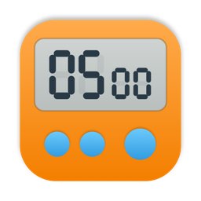

<p align="center">
  
</p>

<h1 align="center">Egg Timer</h1>

<p align="center">A tiny native macOS kitchen timer, modeled on the classic M / S / Start-Stop digital timer.</p>

---

Egg Timer is a single small window with a big `MM:SS` display and the same few buttons as the plastic timer on your fridge. Set a time, hit Start, and it beeps until you stop it.

## Features

- **Countdown or stopwatch.** Start from a set time to count down, or from 00:00 to count up (to 99:59).
- **Pause and resume.** Press Start/Stop again to pause, then again to carry on.
- **Recall.** After the alarm is silenced, the display returns to the last time you set, so rerunning it is one press.
- **17 alarm tones.** Three synthesized tones (Classic Beep, Digital Chirp, Alarm Clock) plus every built-in macOS alert sound. Picking a tone in Settings plays a preview.
- **Always on Top.** Keep the timer floating over other windows, on every Space.
- **Keyboard-friendly.** Every control has a shortcut.
- **No drift.** Time is measured against the clock, not by counting ticks.

## Controls

| Action | Button | Shortcut |
| --- | --- | --- |
| Add a minute (hold to repeat) | **M** | `M` |
| Add a second (hold to repeat) | **S** | `S` |
| Start / stop / pause | **Start** | `Space` |
| Reset to 00:00 | **Clear** | `Esc` |
| Silence the alarm | any button | any shortcut |
| Always on Top | pin icon | `⌥⌘T` (also in the Window menu) |
| Choose the alarm tone | — | `⌘,` (Settings) |

M and S are ignored while the timer is running, like on the real thing.

## Requirements

- macOS 15 or later (Apple Silicon or Intel)
- Xcode 16 or later to build
- [XcodeGen](https://github.com/yonaskolb/XcodeGen) only if you change `project.yml` (`brew install xcodegen`)

## Install

Build a Release copy and copy it into Applications:

```bash
xcodebuild -scheme EggTimer -configuration Release -derivedDataPath build build
```

```bash
rm -rf /Applications/EggTimer.app && ditto build/Build/Products/Release/EggTimer.app /Applications/EggTimer.app
```

```bash
open /Applications/EggTimer.app
```

Quit Egg Timer before reinstalling. Because you built it yourself, macOS opens it without a Gatekeeper warning.

## Development

Open `EggTimer.xcodeproj` in Xcode, or build and test from the command line:

```bash
xcodebuild -scheme EggTimer -derivedDataPath build test
```

The Xcode project is generated from `project.yml`. After adding files or changing build settings there, run `xcodegen generate`.

### Project layout

| Path | What it is |
| --- | --- |
| `EggTimer/TimerModel.swift` | All timer logic: buttons, countdown/count-up, alarm. Takes an injectable clock for tests. |
| `EggTimer/ContentView.swift` | The window: display, buttons, pin toggle. |
| `EggTimer/AlarmPlayer.swift` | Alarm tones, including the synthesized ones. |
| `EggTimer/SettingsView.swift` | Settings window with the tone picker. |
| `EggTimer/WindowLevelSetter.swift` | Applies Always on Top to the window. |
| `EggTimerTests/` | Unit tests (Swift Testing). |
| `Tools/make-icon.swift` | Draws the app icon and writes the asset set. |

### Icon

The app icon is drawn in code. After editing the script, regenerate it with:

```bash
swift Tools/make-icon.swift
```

## License

Copyright 2026 Andrew Egelhof

Licensed under the [Apache License, Version 2.0](LICENSE).
